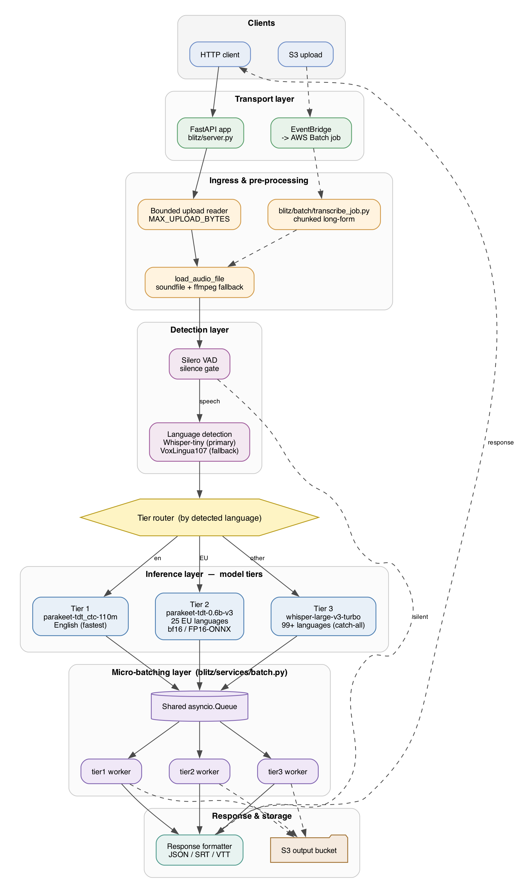

# Blitz ASR

GPU-accelerated speech-to-text with intelligent model routing and speaker diarization. Supports 100+ languages via Parakeet (25 EU languages) and Whisper (100+ languages).

## Features

- **3-Tier Model Routing**: Tier 1 (CTC-110M, English), Tier 2 (Parakeet 0.6B, 25 EU languages), Tier 3 (Whisper, 100+ languages)
- **Speaker Diarization**: Identify "who spoke when" using NeMo MSDD + CTC forced alignment
- **Automatic language detection** with Whisper + VoxLingua107 fallback
- **Intelligent routing** to optimal model based on detected language
- **Silent audio detection**: VAD on CPU skips silent files, saving GPU cost
- **High throughput**: 1.6 min/s capacity, 0.55 req/s
- **Multiple outputs**: text, JSON, SRT, VTT with timestamps
- **Long-form audio**: chunking with overlap for hours of content
- **Observability**: Prometheus metrics, structured JSON logging, GPU monitoring
- **Security**: API key authentication, rate limiting, CORS, request validation

## Architecture



Request flow (solid) and AWS Batch flow (dashed) share the same ingress, detection, and inference layers. See [docs/ARCHITECTURE.md](docs/ARCHITECTURE.md) for details.

## Deployment Options

| Mode | Use Case | Trigger |
|------|----------|---------|
| **HTTP API** | Real-time transcription | REST endpoint |
| **AWS Batch** | Bulk file processing | S3 upload |

---

## HTTP API Mode

Synchronous FastAPI service with micro-batching for optimal GPU utilization.

### Quick Start (Docker Compose)

The easiest way to get started:

```bash
# Copy environment config
cp .env.example .env

# Build and start (first run: ~15-20 min for model downloads)
docker compose up -d --build

# Watch logs until "Application startup complete"
docker compose logs -f

# Test transcription
curl -X POST http://localhost:8000/transcribe \
  -F "file=@tests/fixtures/english.mp3" -F "format=json"

# Test speaker diarization
curl -X POST http://localhost:8000/diarize \
  -F "file=@tests/fixtures/meeting.mp3" -F "format=json"
```

### Quick Start (Manual)

```bash
# Build
docker build -t blitz:latest .

# Run
docker run --gpus all --ipc=host --ulimit memlock=-1 --ulimit stack=67108864 \
  --shm-size=2g -p 8000:8000 --name blitz --env-file .env \
  -v ~/.cache/huggingface:/root/.cache/huggingface \
  blitz:latest

# Test
curl -X POST http://localhost:8000/transcribe \
  -F "file=@audio.wav" -F "format=json"
```

### Interactive Notebooks

For step-by-step guides, see the `notebooks/` directory:
- `01_quickstart_local.ipynb` - Get running on a GPU instance
- `02_aws_batch_deployment.ipynb` - Deploy AWS Batch for production scale

---

## API Endpoints

### POST /transcribe

Transcribe audio with automatic language detection and intelligent model routing.

| Parameter | Type | Description |
|-----------|------|-------------|
| `file` | File | Audio file (WAV, MP3, M4A, FLAC) |
| `format` | String | `text`, `json`, `srt`, `vtt` (default: text) |
| `language_hint` | String | ISO 639-1 code to skip detection |

**Response (JSON):**
```json
{
  "text": "Hello world.",
  "language": {
    "code": "en",
    "confidence": 0.98,
    "top_languages": [{"code": "en", "confidence": 0.98}],
    "detection_method": "whisper",
    "detection_model": "whisper-large-v3-turbo"
  },
  "engine": "tier1",
  "duration_sec": 24.0,
  "timestamps": null,
  "metrics": {
    "real_time_factor": 0.069,
    "cost_per_1000_min_audio_usd": {"spot": 0.03}
  }
}
```

### POST /diarize

Transcribe audio with speaker diarization — identifies "who said what" with timestamps.

| Parameter | Type | Description |
|-----------|------|-------------|
| `file` | File | Audio file (WAV, MP3, M4A, FLAC) |
| `format` | String | `json` or `text` (default: json) |
| `language` | String | Language code (optional, auto-detected) |

**Response (JSON):**
```json
{
  "text": "Speaker 0: Hello, how are you?\nSpeaker 1: I'm doing great.",
  "duration_sec": 15.2,
  "diarization": {
    "num_speakers": 2,
    "speakers": ["Speaker 0", "Speaker 1"],
    "segments": [
      {
        "speaker": "Speaker 0",
        "start": 0.5,
        "end": 3.2,
        "text": "Hello, how are you?"
      },
      {
        "speaker": "Speaker 1",
        "start": 3.8,
        "end": 6.1,
        "text": "I'm doing great."
      }
    ],
    "method": "whisper-diarization (MSDD)"
  },
  "srt": "1\n00:00:00,500 --> 00:00:03,200\nSpeaker 0: Hello, how are you?\n...",
  "metrics": {
    "total_processing_time_sec": 4.5,
    "diarization_time_sec": 2.1
  }
}
```

### GET /health

Health check with model status.

### GET /metrics

Prometheus metrics endpoint for monitoring (see [Observability](#observability)).

---

## Speaker Diarization

Blitz includes state-of-the-art speaker diarization powered by [whisper-diarization](https://github.com/MahmoudAshraf97/whisper-diarization), which combines:

- **faster-whisper** — Transcription with word-level timestamps
- **NeMo MSDD** — Multi-Scale Diarization Decoder for speaker segmentation
- **CTC Forced Aligner** — Precise word-to-timestamp alignment
- **Deep Multilingual Punctuation** — Automatic punctuation restoration

### Setup

```bash
# Inside the container (or during Docker build):
cd /tmp && git clone https://github.com/MahmoudAshraf97/whisper-diarization
pip install git+https://github.com/MahmoudAshraf97/ctc-forced-aligner.git deepmultilingualpunctuation
```

### Usage

```bash
# Via API
curl -X POST http://localhost:8000/diarize \
  -F "file=@meeting.mp3" -F "format=json"

# Direct script (for testing)
python /tmp/whisper-diarization/diarize_parallel.py \
  --whisper-model large-v3 -a meeting.mp3
```

### Performance

| Audio Length | Processing Time | Notes |
|---|---|---|
| 10s | ~10-15s | First call loads models |
| 5 min | ~30-40s | Normal processing |
| 30 min | ~90-100s | ~3x real-time |

---

## Observability

Production monitoring with Prometheus metrics, structured logging, and GPU monitoring.

### Metrics Endpoint

```bash
curl http://localhost:8000/metrics
```

Key metrics exposed:
- `blitz_requests_total` — Request count by endpoint/status
- `blitz_transcriptions_total` — Successful transcriptions by engine/language
- `blitz_tier_routing_total` — Requests routed to each tier
- `blitz_audio_minutes_processed_total` — Cumulative audio processed
- `blitz_gpu_memory_used_bytes` — GPU VRAM usage
- `blitz_gpu_utilization_percent` — GPU compute utilization
- `blitz_real_time_factor` — Processing speed distribution

### Structured Logging

All logs output as JSON for CloudWatch/ELK ingestion:
```json
{
  "timestamp": "2026-05-06T17:00:00+00:00",
  "level": "INFO",
  "message": "Request completed: 200 in 1.234s",
  "service": "blitz-asr",
  "request_id": "a1b2c3d4"
}
```

### Response Headers

Every response includes:
- `X-Request-ID` — Correlation ID for tracing
- `X-Processing-Time` — Server-side latency
- `X-RateLimit-Limit` — Rate limit ceiling
- `X-RateLimit-Remaining` — Remaining requests in window

### Monitoring Stack (Optional)

Deploy Prometheus + Grafana alongside Blitz. A Grafana admin password is
required (the stack refuses to start without it):
```bash
# Generate a password and export it (or add it to .env)
export GRAFANA_ADMIN_PASSWORD="$(python3 -c 'import secrets; print(secrets.token_urlsafe(24))')"

docker compose -f docker-compose.yml \
  -f observability/docker-compose.observability.yml up -d
```

Grafana and Prometheus bind to `127.0.0.1` only (localhost). Access Grafana at
http://localhost:3000 (user `admin`, or override with `GRAFANA_ADMIN_USER`).

See [observability/README.md](observability/README.md) for full documentation.

---

## Security

Application-level security with API key authentication, rate limiting, and request validation.

### Configuration

```bash
# .env
BLITZ_AUTH_ENABLED=true
BLITZ_API_KEYS={"myapp": ["blitz_abc123"], "partner": ["blitz_def456"]}
BLITZ_RATE_LIMIT_ENABLED=true
BLITZ_RATE_LIMIT_RPM=60
BLITZ_CORS_ORIGINS=http://localhost:8501,https://myapp.com
```

### API Key Authentication

```bash
# With auth enabled, provide X-API-Key header:
curl -X POST http://localhost:8000/transcribe \
  -H "X-API-Key: blitz_abc123" \
  -F "file=@audio.mp3" -F "format=json"

# Public endpoints (/health, /metrics) don't require a key
```

### Rate Limiting

- 60 requests/minute per client (configurable)
- 10 burst allowance above normal rate
- Returns `429 Too Many Requests` with `Retry-After` header

### Generate API Keys

```bash
python3 -c "import secrets; print(f'blitz_{secrets.token_urlsafe(32)}')"
```

See [blitz/security/README.md](blitz/security/README.md) for full documentation.

---

## AWS Batch Mode

Event-driven processing triggered by S3 uploads.

```
S3 Input --> EventBridge --> AWS Batch --> S3 Output
```

### Deploy

```bash
./scripts/deploy_batch.sh \
  --environment dev \
  --region us-east-1 \
  --vpc-id vpc-xxx \
  --subnet-ids subnet-aaa,subnet-bbb
```

### Use

```bash
# Upload triggers transcription
aws s3 cp audio.mp3 s3://blitz-input-dev-123456789012/

# Get result
aws s3 cp s3://blitz-output-dev-123456789012/transcripts/audio.json .
```

See [docs/BATCH_PROCESSING.md](docs/BATCH_PROCESSING.md) for full configuration.

---

## Performance

Benchmarked on g6.xlarge (NVIDIA L4 24GB):

| Metric | Value |
|--------|-------|
| Throughput | 0.55 req/s |
| Capacity | 1.6 min audio/s |
| RTF | 0.006-0.01 |

> **Coming soon:** We will benchmark the g7 instance type (NVIDIA RTX PRO 4500 Blackwell, 32GB GDDR7; Intel Xeon 6) in the future. We expect cost-performance gains over g6 (NVIDIA L4) from the newer GPU architecture and larger, faster VRAM.

### Cost per 1000 Minutes (Spot)

| Engine | Languages | Cost |
|--------|-----------|------|
| tier1 | English | **$0.03** |
| tier2 | 25 EU languages | $0.06-0.08 |
| tier3 | 100+ languages | $0.08-0.15 |

### Pricing Data

Hourly GPU rates live in [`blitz/config.py`](blitz/config.py) as `gpu_price_*` fields, overridable via `GPU_PRICE_*` environment variables. Refresh with:

```bash
pip install boto3
python scripts/update_pricing.py --instance-type g6.xlarge --region us-east-1
```

## Model Routing

| Audio Language | Model | Speed | Accuracy | Notes |
|----------------|-------|-------|----------|-------|
| English | CTC-110M | 233x | 92.5% | Fast mode (default) |
| 24 EU languages | Parakeet 0.6B | 154x | 94.5% | High accuracy |
| 100+ languages | Whisper | ~50x | 90%+ | Wide coverage |

## Precision Modes

| Mode | Speed | Accuracy | Use Case |
|------|-------|----------|----------|
| bfloat16 (default) | 154x | 94.5% | Production |
| fp32 | 100x | 94.3% | Max accuracy |
| onnx fp16 | 167x | 89.7% | Max speed |

## Configuration

| Variable | Default | Description |
|----------|---------|-------------|
| `TIER1_LANGUAGES` | en | Languages routed to Tier 1 (CTC-110M) |
| `TIER2_LANGUAGES` | bg,hr,cs,... | Languages routed to Tier 2 (Parakeet 0.6B) |
| `TIER2_PRECISION` | bfloat16 | `fp32`, `bfloat16`, `fp16` |
| `BATCH_TIMEOUT_MS` | 15 | Max wait for micro-batch (0-15ms latency) |
| `MAX_BATCH_SIZE` | 4 | Requests per batch |
| `BLITZ_AUTH_ENABLED` | false | Enable API key authentication |
| `BLITZ_RATE_LIMIT_RPM` | 60 | Requests per minute per client |
| `BLITZ_CORS_ORIGINS` | * | Allowed CORS origins |

## Requirements

- Docker with NVIDIA GPU support
- NVIDIA GPU with 24GB+ VRAM (L4, A10G, A100)
- NVIDIA Driver 550+ (CUDA 12.x compatible)
- Recommended AMI: Deep Learning OSS Nvidia Driver AMI GPU PyTorch 2.10 (Amazon Linux 2023)
- Recommended instance: g6.xlarge (NVIDIA L4, Spot @ $0.42/hr)

## Project Structure

```
.env.example            # Configuration template
docker-compose.yml      # One-command setup
Dockerfile              # HTTP API image (base: nvcr.io/nvidia/pytorch:24.12-py3)
blitz/
  models/               # Parakeet, Whisper, VoxLingua wrappers
  services/             # Transcription, language detection, VAD, diarization
  observability/        # Prometheus metrics, structured logging, middleware
  security/             # API key auth, rate limiting, CORS, validation
  batch/                # AWS Batch processing
  server.py             # FastAPI HTTP server
  config.py             # Environment configuration
  diarize_endpoint.py   # /diarize endpoint (whisper-diarization integration)
docker/
  Dockerfile.batch      # AWS Batch image
  Dockerfile.onnx       # ONNX backend image
observability/
  prometheus.yml        # Prometheus scrape config
  docker-compose.observability.yml  # Monitoring stack (Prometheus + Grafana)
  grafana/              # Pre-built dashboards and provisioning
notebooks/              # Interactive getting-started guides
scripts/                # Deployment and utility scripts
tests/fixtures/         # Test audio files (25+ languages)
```

## Documentation

- [API Documentation](docs/API_DOCUMENTATION.md)
- [Architecture](docs/ARCHITECTURE.md)
- [Batch Processing](docs/BATCH_PROCESSING.md)
- [Deployment Guide](docs/DEPLOYMENT_GUIDE.md)
- [Benchmark Results](docs/benchmark-results.md)
- [Observability](observability/README.md)
- [Security](blitz/security/README.md)

## Streamlit UI

A multi-tab Streamlit frontend is available for interactive use:

```bash
pip install streamlit requests
streamlit run blitz_app.py
```

Tabs:
1. 🎙️ **Transcribe** — Single file transcription with progress bar
2. 🗣️ **Speaker Diarization** — Multi-speaker identification with color-coded output
3. 🌍 **Multi-Language Testing** — Batch language testing with routing verification
4. 📊 **Performance Benchmark** — Throughput and latency testing
5. 🖥️ **System Monitor** — Live GPU, request, and tier routing metrics

## License

MIT
